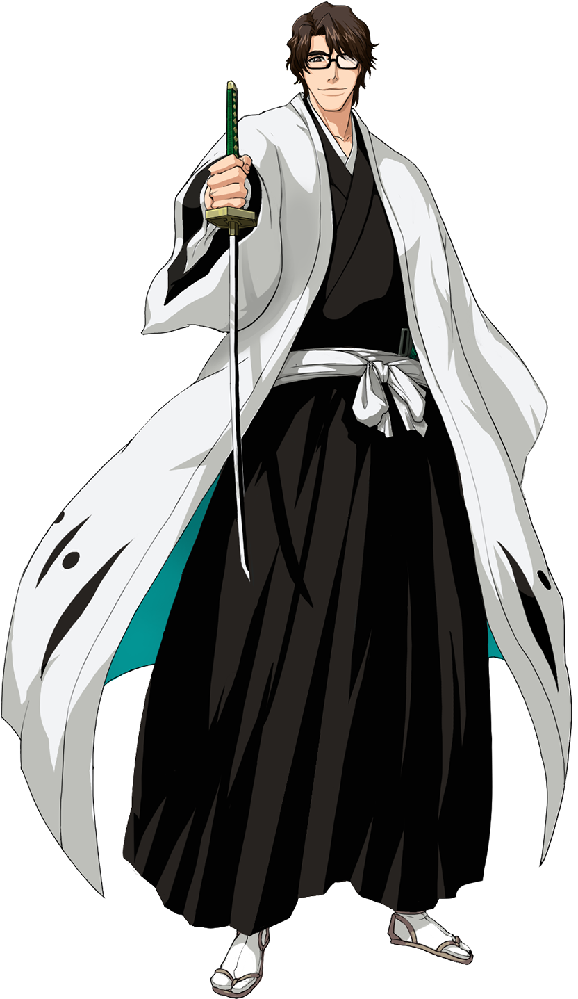

<div align="center">

  


<a href="https://git.io/typing-svg"></a>

</div>

 <!-- Sosuke Aizen Theme — Contact Channels -->

<div align="center">

<a href="https://github.com/durrab64">
  
</a>
&nbsp;&nbsp;
<a href="mailto:YOUR_EMAIL_HERE">
  
</a>
&nbsp;&nbsp;
<a href="YOUR_LINKEDIN_URL_HERE">
  
</a>

 <!-- Miku Visitor Counter -->

 <br/><br/>

<h4>:eye: Soul Society Visitors Count</h4>


</div>

---


 

### 🟣 About Me — Beyond the Limits

*“Admiration is the furthest thing from understanding.”*

Computer Science student, developer, video editor, and esports athlete. I explore different fields, build projects, create content, and keep leveling up.

```text
╔══════════ SYSTEM NOTIFICATION ══════════╗
║                                         ║
║  Player    : Muhammad Durrab            ║
║  Alias     : Sledge                     ║
║  Class     : Developer / Creator        ║
║  Rank      : E → ???                    ║
║  Weapon    : Keyboard + Creativity      ║
║  Main Stack: Node.js | React | UI/UX    ║
║  Arsenal   : After Effects | Premiere   ║
║              Pro | Photoshop            ║
║  Passive   : Adaptability               ║
║  Objective : Build. Create. Compete.    ║
║                                         ║
╚═════════════════════════════════════════╝
```

- 🔮 Exploring frontend, backend, UI/UX, and software development.
- ⚔️ Competing in Tekken and improving through every match.
- 🎬 Creating gaming content, edits, and visual experiences.
- 🧪 Learning by building projects and experimenting with new ideas.

<br clear="right" />

---

<div align="center">

*“Power is not given. It is taken.”*

**WELCOME TO MY DOMAIN**

</div>

## 🟣 Tech Stack & Arsenal

<div align="center">

### 💻 Languages & Frontend


### ⚙️ Backend & Development


### 🧠 Core Computer Science


### 🎨 Design & Editing Arsenal


### 🗄️ Databases & Deployment


### 🛠️ Tools & IDEs


</div>

---

## 🏆 Competitive Gaming Career

**Main Title:** 

| Event | Placement | Achievement |
| :--- | :---: | :--- |
| 🌍 International Tournament | **Top 17** | Reported placement among 250+ players |
| 🥉 SOFTEC | **3rd Place** | University Tekken tournament |
| 🎮 PUCon | **Top 8** | Reported 7th–8th place finish |

---

## 💻 Signature Projects

| Project | Description | Technologies |
| :--- | :--- | :--- |
| 🏎️ **Deals on Wheels** | Car marketplace for browsing vehicle listings and deals. | HTML, CSS, JavaScript, Vite |
| 🛒 **E-Commerce Hub** | Shopping platform with product listings and cart functionality. | Java, Web Technologies |
| ⚔️ **TEKKOO** | Tekken player statistics and competitive gaming platform. | Web Development, APIs, Database |

---

<div align="center">

*「Welcome to my domain.」*


</div>


---


### 📊 GitHub Stats

<div align="center">
  

  
</div>

<div align="center">
  
</div>

---


### :eye: Quote of the Day

<div align="center">

  <h3>
    "Since when were you under the impression that I wasn't using <b>Kyōka Suigetsu</b>?"
  </h3>

  <i>— Sosuke Aizen</i>

</div>

---


### 👾 Pac-Man — Contribution Hunt

<picture>
  <source
    media="(prefers-color-scheme: dark)"
    srcset="https://raw.githubusercontent.com/durrab64/durrab64/output/pacman-contribution-graph-dark.svg"
  />
  <source
    media="(prefers-color-scheme: light)"
    srcset="https://raw.githubusercontent.com/durrab64/durrab64/output/pacman-contribution-graph.svg"
  />
  
</picture>


---


<div align="center">
  
</div>

